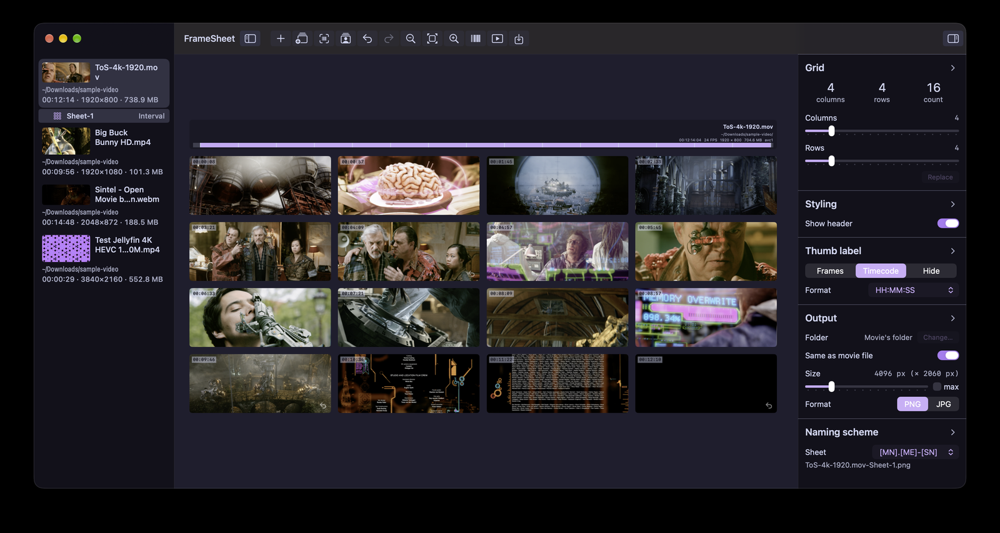

#  FrameSheet

FrameSheet is a macOS app that makes video contact sheets (MoviePrints).

**v3.0.0** is a rebuild that reproduces
[MoviePrint](https://github.com/fakob/MoviePrint_v004) v0.2.23 natively for
Apple Silicon — many movies at once, interval, shot-detection and face sheets,
editable thumbs and scenes, and export as PNG/JPG, JSON and EDL. The target
behavior is in [docs/V3_SPEC.md](docs/V3_SPEC.md); v2 (up to tag `v2.3.1`)
was a settings-to-one-image contact sheet generator.



## Download

Get `FrameSheet-3.0.0.zip` from the
[v3.0.0 release](https://github.com/kni927/FrameSheet/releases/tag/v3.0.0).
The app is signed with a Developer ID and notarized: unzip it, move
FrameSheet.app to Applications and open it. What is new and the known issues
are in the [release notes](docs/release-notes/v3.0.0.md).

## Using FrameSheet

Add movies with the + button, the A key or by dropping them on the
window. Each movie gets a default interval sheet of 16 thumbs in 4 columns,
which you can edit:

- **Hover a thumb** for IN, OUT, insert before/after, EXPAND, HIDE and SAVE
  (each button has a tooltip); hold ⌥ and IN/OUT turn into ◀ HIDE / HIDE ▶,
  which hide every thumb before or after it.
- **Drag the handle** in the middle of a thumb to scrub from its own frame:
  CHANGE TO by default, ⇧ for ADD BEFORE, ⌥ for ADD AFTER, ⌃ to reach the
  start or end of the movie (the overlay names the keys); drop on the Cancel
  bar to cancel. A quick click on the handle keeps the scrub
  open: move to pick, click to confirm, Esc to cancel. With a thumb selected,
  Return scrubs with the arrow keys.
- **Drag a thumb** onto another to reorder; ⇧⌥←/→ move the selection.
- Every command is in the menus (File, Edit, View and Sheet), most with a ⌘
  shortcut: interval sheets (2×2 … 6×6, ⌃⌘2 … ⌃⌘6), shot-detection (⇧⌘D) and
  faces sheets, duplicate (⌘D), undo and redo, zoom (⌘− / ⌘0 / ⌘=, fit height
  ⌃⌘0, fit width ⌥⌘0), hidden thumbs (⇧⌘H), the header (⇧⌘E), the thumb
  label, grid and timeline view (G, ⌘G), mean colors only in the timeline,
  optimize the grid, save the sheet (M, ⌘S) and both sidebars (1, 3, ⌘1, ⌘3).
  The window toolbar holds the common ones; **View → Customize Toolbar…** adds
  the rest or rearranges them.
- **Add shot-detection sheet** (toolbar) scans the movie once for shots and
  streams the scenes into a shot sheet in timeline view (progress and Cancel
  in the toast, or Esc; the same button resumes a cancelled scan, and
  **Rescan for Shots** in the movie's menu starts over; about 9 min for a 2 h
  1080p film). Scanned movies get an "S" on
  their poster. The timeline lays scenes out in rows of a set movie time
  (Minutes per row), as wide as they are long; click a scene to see it at
  full width. A new threshold in the settings panel makes a new sheet from
  the stored scan without scanning again. Interval sheets can be shown as a
  timeline too.
- **Hover a scene** in the timeline for EXPAND (a child sheet inside the
  scene), HIDE, ◀ HIDE / HIDE ▶, jump to the cut before or after, and a scrub
  limited to the scene. **Sheet → Cut Scene** (⌘K) cuts the selected scene at
  its thumb and **Merge with Previous / Next Scene** (⌘[ / ⌘]) merges it.
  **F** (⇧⌘C) opens the detection chart (difference per frame, threshold and
  cuts).
- **Player view** (2, Space, the toolbar, or a double-click on a thumb or
  scene): the movie with a strip of consecutive frames around the current
  one, the sheet as one row, and a timeline bar. Step with ←/→ (±10),
  ⇧ (±1), ⌥ (±100), ⇧⌥ (previous/next cut or thumb); P plays (with audio;
  files read with ffmpeg play video only). Return cuts or merges at the
  current frame on shot sheets (Space switches to changing the thumb), and
  changes the thumb (⇧ adds before, ⌥ after) on interval sheets; S saves the
  current frame.
- **Automatic IN/OUT** (Grid section, More) skips black frames at the start
  and end of a movie when it is added, with a brightness threshold; Apply
  sets them on the current sheet.
- **Save sheet** writes the sheet as PNG or JPG (1024–16384 px or max; the
  height in timeline view) with an
  optional header (file name, folder, details, mini timeline). A PNG carries
  the frame list in MoviePrint-compatible text chunks. Options: folder, file
  name templates (`[MN]` `[ME]` `[SN]` `[FN]` `[TC]`), overwrite or " edit N",
  and a folder with each thumb as its own image. **Export JSON** is in a
  sheet's menu, and **Export EDL** (CMX3600) for shot sheets. **Save All
  Sheets** (File menu, ⌥⌘S) saves every sheet of every movie in turn,
  with progress and Cancel; a movie without a sheet gets the default one.
- **Import Sheet…** (File menu, ⇧⌘I, or the + button, or a drop) reads a PNG or
  JSON saved by FrameSheet or MoviePrint 0.2.x and adds the movie with that
  sheet. A moved movie shows "Movie is missing" with Locate…; **Replace
  movie…** relinks a movie and keeps its sheets; **Clear Movie List…** (File
  menu) asks first and can be undone.
- The settings panel (3) sets columns (rearranges live), target rows and
  Replace (recaptures columns × rows thumbs), header, margins, corner radius,
  the timeline (minutes per row, natural flow, scene width ratio, min scene
  width, shot threshold), the thumb label (frames, with the last frame
  number, or a timecode format; font, size, colors, position), output and
  file names; each section opens with its chevron. The movie list (1) renames,
  duplicates, deletes and exports sheets. The thumbnail cache and ffmpeg are
  in Settings (⌘,), with the shot detection method (Experimental) and
  **Fetch exact frames with ffmpeg** (on by default):
  some files (open-GOP H.264) have frames AVFoundation cannot decode, and
  ffmpeg fetches those; without it such thumbs show the nearest decodable
  frame with a marker.
- **Add faces sheet** (toolbar or Sheet menu: every 10th frame, ⇧⌘F, every
  100th frame, or these thumbs) looks for faces with Apple Vision between the
  sheet's first and last thumb, on the multiples of 10 or 100, so a faces
  sheet from another sheet of the movie reuses the frames already analyzed,
  and makes a faces sheet of the frames with faces, largest face first. It reads the frames in the shot scan's pass, so a movie not yet
  scanned for shots gets that scan up to the last frame too; Cancel or Esc
  keeps what was found, and the same scope resumes. **Sort** (reverse, frame
  number; face count, size, confidence on faces sheets) and **Filter** (face
  count, face size) are one undo step each; the toolbar shows or hides the
  face rectangles (in the window and the player; in saved sheets with
  Output → Include face rectangles). The confidence and size thresholds are
  in **Sheet → Face Detection…** (⌥⌘D); Apply rescans the current faces sheet
  with them.
  A movie's stored shot and face scans can be deleted with **Clear Stored
  Scans** in its menu. Each scan writes timings to
  `~/Library/Logs/FrameSheet/scan.log`.
- **Edit Rotation, Cropping and Aspect Ratio…** in a movie's menu turns the
  frames by 90° steps, crops them (presets or pixels per edge, with a
  preview) and sets the ratio thumbs are shown and saved at, for the grid,
  scrub, player, scans and saved images alike; undoable. Changing the
  rotation or crop clears the movie's stored scans.
- ⌘Z / ⇧⌘Z undo and redo up to 50 edits.

## Requirements

- macOS 27 or later on Apple Silicon.
- **FFmpeg**, only for files AVFoundation cannot decode (WebM, MKV, WMV, HEVC
  tagged `hev1`). FrameSheet looks for a chosen path, then your login shell's
  `PATH`, then the usual install directories (Homebrew, MacPorts, Nix).

```bash
brew install ffmpeg
```

## Building

Requires Xcode 27.

```bash
./build.sh
```

The app is assembled at `./build/FrameSheet.app` (with a zip next to it);
SwiftPM's build products stay in `~/Library/Caches/FrameSheet/build`.
`scripts/release.sh X.Y.Z` builds a release from a clean checkout, notarizes
and staples it (a notarytool keychain profile is needed) and leaves
`build/FrameSheet-X.Y.Z.zip`. Run the
core tests with:

```bash
swift test --scratch-path ~/Library/Caches/FrameSheet/build
```

## Author

Created and maintained by **kni**.

## License

This project is licensed under the MIT License - see the [LICENSE](LICENSE) file for details.
MoviePrint code ported into FrameSheet keeps its MIT notice
([docs/licenses/MoviePrint-LICENSE](docs/licenses/MoviePrint-LICENSE)); the
Catppuccin palette is MIT as well
([docs/licenses/Catppuccin-LICENSE](docs/licenses/Catppuccin-LICENSE)).
