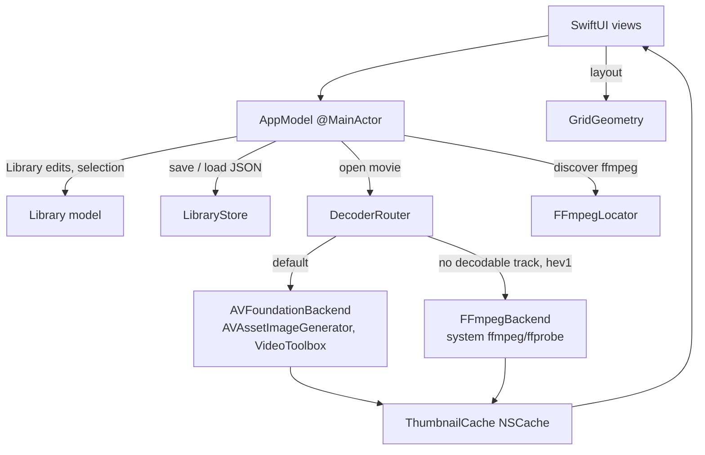

# Architecture - FrameSheet

## System Overview

FrameSheet v3 is a Swift package with a UI-free core library and a SwiftUI
app. The core holds the document model, the layout maths, persistence and
the decode layer; the app holds the window, the views and the app state. v2
(`src/`, a `swiftc`-only build) was removed with the v3 skeleton and stays
at tag v2.3.1.



## Package layout

```
Package.swift                    Swift 6, macOS 27, arm64
Sources/FrameSheetCore/          no SwiftUI or AppKit
├── Models.swift                 Library, MovieFile, Sheet, Thumb, Scene,
│                                Settings, Defaults (all Codable)
├── IntervalFrames.swift         mapRange + getIntervalArray (MoviePrint),
│                                sheet naming, timecode
├── GridGeometry.swift           grid part of MoviePrint getScaleValueObject
├── LibraryStore.swift           JSON in Application Support
└── Decode/
    ├── DecodeBackend.swift      protocol, MediaInfo, DecodedFrame, errors
    ├── AVFoundationBackend.swift  probe, zero-tolerance thumbs + ±0.5 s retry
    ├── FFmpegBackend.swift      ffprobe probe, packet-scan duration,
    │                            one input-seeking ffmpeg run per frame (×5)
    ├── DecoderRouter.swift      AVFoundation first, ffmpeg fallback
    ├── FFmpegLocator.swift      user path → login shell → known directories
    ├── ProcessRunner.swift      shell-free Process with timeout/cancel
    └── ThumbnailCache.swift     NSCache limited by pixel bytes (256 MB)
Sources/FrameSheet/              the app
├── FrameSheetApp.swift          Window scene, AppDelegate, single-key keys
├── AppModel.swift               @Observable state, adding movies, selection,
│                                thumbnail loading, debounced saving
├── ContentView.swift            split view, toolbar, drop target, footer, toast
├── MovieListView.swift          movie rows with posters, sheet rows
├── SheetGridView.swift          grid of the selected sheet
├── SettingsPanel.swift          settings sidebar (ffmpeg row so far)
└── Theme.swift                  Catppuccin Mocha colours
Tests/FrameSheetCoreTests/       swift test (Swift Testing)
assets/AppIcon.png               build.sh → .icns
tools/spike/                     separate measurement package
```

## Core model

`Library` is the whole document: movies in list order (`MovieFile`, with a
bookmark, probe data, IN/OUT, transform, scan state and a sheet counter),
sheets per movie (`Sheet`: type, view, columns, seconds per row, parent,
thumbs, scenes), global `Settings`, and the selection. Sheet names are
`MoviePrint-N` from the per-movie counter. Interval sheets take N frame
numbers evenly between IN and OUT with MoviePrint's own rounding. The app
mutates the library on the main actor and saves it as JSON half a second
after each change; it is loaded once on launch. Settings decode with defaults
for missing keys so later versions can add fields.

## Decoding

Movies open through `DecoderRouter`: AVFoundation first; the file goes to
ffmpeg when AVFoundation has no video track, the track is not decodable, or
the HEVC sample entry is `hev1` (VideoToolbox rejects it although the track
claims to be decodable). Frames are addressed by number. AVFoundation asks
for the middle of a frame's display interval with zero tolerance and retries
a failure once with ±0.5 s, reporting the frame actually decoded (decision
11); the app then moves the thumb to that frame. The ffmpeg path seeks half a
frame early, takes the first frame from a PNG pipe, five runs at a time in
software decode, and retries 0.5 s earlier when the frame count estimated
from the duration runs past the last frame. Sequential scanning
(`AVAssetReader`, shot and face scans) is not built yet; its design is in
`docs/V3_SPEC.md` §10.

ffmpeg is found in the order of §10 (user path, login-shell `command -v`,
known directories), each candidate validated with `ffmpeg -version`;
`ffprobe` must sit next to it.

## Display

`GridGeometry` reproduces MoviePrint's grid sizes (thumb width = movie width
× 0.25, margin from the margin ratio, rounded corners, header height) and
scales the print to fit the main area at zoom 1. Thumbs are decoded at 640 px
wide (posters at 320 px) into `ThumbnailCache`; views re-read the cache when
`AppModel.imageGeneration` changes.

## Dependencies

No bundled binaries and no packages. `ffmpeg`/`ffprobe` are optional, needed
only for files AVFoundation cannot decode.
