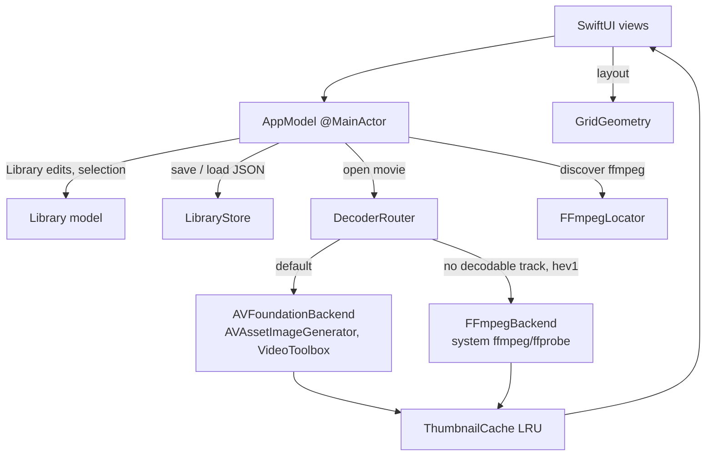

# Architecture - FrameSheet

## System Overview

FrameSheet v3 is a Swift package with a UI-free core library and a SwiftUI
app. The core holds the document model, the layout math, persistence and
the decode layer; the app holds the window, the views and the app state. v2
(`src/`, a `swiftc`-only build) was removed with the v3 skeleton and stays
at tag v2.3.1.



## Package layout

```
Package.swift                    Swift 6, macOS 27, arm64
Sources/FrameSheetCore/          no SwiftUI or AppKit
├── Models.swift                 Library, MovieFile, Sheet, Thumb, Scene,
│                                Settings, Defaults (all Codable)
├── IntervalFrames.swift         mapRange + getIntervalArray (MoviePrint),
│                                sheet naming, timecode
├── GridGeometry.swift           grid part of MoviePrint getScaleValueObject
├── LibraryStore.swift           JSON in Application Support
├── Editing/
│   ├── EditHistory.swift        50-step undo/redo; EditableLibrary.edit
│   ├── IntervalEditing.swift    thumb and sheet operations, interval scenes
│   ├── Scrub.swift              pointer → frame mapping, scrub actions
│   ├── GridLayout.swift         optimized columns, stats line, zoom, frame info
│   └── ThumbNavigation.swift    next/previous thumb, dimming, scrub layout
├── Export/
│   ├── FileNaming.swift         [MN] [ME] [SN] [FN] [TC] templates, " edit N"
│   ├── PNGText.swift            tEXt chunks before IEND, CRC32
│   ├── SheetExchange.swift      MoviePrint-compatible PNG/JSON data, import
│   ├── PrintHeader.swift        header lines, mini timeline, metrics
│   ├── PrintOutput.swift        output size and max, decode width, 8-bit encoding
│   └── IncomingFiles.swift      route PNG/JSON to import, the rest to movies
├── PathDisplay.swift            ~/… for paths under home
└── Decode/
    ├── DecodeBackend.swift      protocol, MediaInfo, DecodedFrame, errors
    ├── AVFoundationBackend.swift  probe, zero-tolerance thumbs + ±0.5 s retry
    ├── FFmpegBackend.swift      ffprobe probe, packet-scan duration,
    │                            one input-seeking ffmpeg run per frame (×5)
    ├── DecoderRouter.swift      AVFoundation first, ffmpeg fallback
    ├── FFmpegLocator.swift      user path → login shell → known directories
    ├── ProcessRunner.swift      shell-free Process with timeout/cancel
    └── ThumbnailCache.swift     LRU cache limited by pixel bytes (256 MB)
Sources/FrameSheet/              the app
├── FrameSheetApp.swift          Window scene, menus, AppDelegate, key monitor
├── AppModel.swift               @Observable state over an EditableLibrary:
│                                edits, selection, zoom, scrub, thumbnail
│                                loading, debounced saving, import, relink
├── AppModel+Save.swift          Save sheet, Save thumb, each thumb, Export JSON
├── PrintView.swift              the print (header, thumbs, frame info), drawn
│                                in the window and by ImageRenderer for saving
├── ContentView.swift            split view, inspector, title and sidebar
│                                toggle, drop target, toast
├── SheetToolbar.swift           sheet tools in the window toolbar
├── MovieListView.swift          movie rows, sheet rows, context menus, Locate
├── SheetGridView.swift          grid, thumbs, hover overlay, frame info,
│                                reorder, placeholder rows
├── ScrubOverlay.swift           scrub overlay with neighbours and Cancel bar
├── SettingsPanel.swift          right panel: grid, styling, frame info
├── SettingsWindow.swift         Settings (⌘,): thumbnail cache, ffmpeg
└── Theme.swift                  kni tokens, system fonts, panel and toolbar styles
Tests/FrameSheetCoreTests/       swift test (Swift Testing)
assets/AppIcon.png               build.sh → .icns
tools/spike/                     separate measurement package
```

## Core model

`Library` is the whole document: movies in list order (`MovieFile`, with a
bookmark, probe data, IN/OUT, transform, scan state and a sheet counter),
sheets per movie (`Sheet`: type, view, columns, seconds per row, parent,
thumbs, scenes), global `Settings`, and the selection. Sheet names are
`Sheet-N` from the per-movie counter (libraries before version 2 have their
`MoviePrint-N` names renamed on load). Interval sheets take N frame
numbers evenly between IN and OUT with MoviePrint's own rounding. The app
mutates the library on the main actor and saves it as JSON half a second
after each change; it is loaded once on launch. Settings decode with defaults
for missing keys so later versions can add fields.

## Editing

Every user-visible edit goes through `AppModel.edit`, which runs a `Library`
operation inside `EditableLibrary.edit`: the library before the edit becomes
one undo step (50 kept, not persisted), and the change is saved and its new
frames decoded. Selection, zoom and global settings change without an undo
step. The operations follow MoviePrint: insert takes the frame midway to the
visible neighbour, IN/OUT recapture the visible count between the new limits,
Expand makes a child sheet over the thumb's interval scene (scenes split at
the midpoints between visible thumbs) whose id is the thumb's id, and the
scrub maps the pointer between the neighbours (Shift, Option and Control
change the range; the first and last thumb extend to the movie's ends). The
scrub decodes at display size with one request in flight and the latest
position next; release applies the exact frame as one undo step.

## Decoding

Movies open through `DecoderRouter`: AVFoundation first; the file goes to
ffmpeg when AVFoundation has no video track, the track is not decodable, or
the HEVC sample entry is `hev1` (VideoToolbox rejects it although the track
claims to be decodable). Frames are addressed by number. AVFoundation asks
for the middle of a frame's display interval with zero tolerance and retries
a failure once with ±0.5 s, reporting the frame actually decoded (decision
11); the app then moves the thumb to that frame. The ffmpeg path seeks half a
frame early, takes the first frame from a PNG pipe, five runs at a time in
software decode, and retries 0.5 s earlier when the frame count estimated
from the duration runs past the last frame. Sequential scanning
(`AVAssetReader`, shot and face scans) is not built yet; its design is in
`docs/V3_SPEC.md` §10.

Near the end of a movie the retry window is moved inside the movie (center at
most end − 0.5 s). A file whose sync samples are open-GOP I frames decodes
only partly with AVFoundation (KNOWN_ISSUES 5), so a frame the generator
misses goes through `EarlierGOPReader` (an `AVAssetReader` from the previous
sync sample) and then, with the Settings option on, `FFmpegFrameFallback`
(decision 25); every `DecodedFrame` names its decoder and whether it is exact,
and the app marks inexact thumbs and refuses an inexact scrub. The ffmpeg path
seeks a little early and picks the frame by its pts (`select` + `showinfo`), so
it is frame-exact, including leading B frames. `ThumbnailCache` is a
least-recently-used cache that drops images only past its byte limit (an
`NSCache` dropped them under memory pressure, so other sheets redrew).

## Saving and import

`PrintView` draws the print once for both the window and the saved file: the
window adds its interaction layer (hover, selection, placeholders, drag) on
top. Save sheet decodes the print's frames fresh at twice the output thumb
width (capped at the movie width) in small sequential batches through
`DecodeGate`, renders with `ImageRenderer` (standard dynamic range), converts
to 8-bit sRGB and encodes off the main actor; a PNG gets MoviePrint's `tEXt`
chunks (`version` "FrameSheet x.y.z", `filePath`, `transformObject`,
`columnCount`, `frameNumberArray`, `sceneArray`). Import reads those chunks
or the JSON export (also MoviePrint 0.2.x files), adds a new movie entry and
sheet, probes the movie and keeps the frame numbers. Every way files enter
(Add movies, drop, Import Sheet…, Open With) goes through
`AppModel.openFiles`, which sends PNG and JSON to import.

ffmpeg is found in the order of §10 (user path, login-shell `command -v`,
known directories), each candidate validated with `ffmpeg -version`;
`ffprobe` must sit next to it.

## Display

Views use the kni Design System through `Theme`: Catppuccin Mocha surfaces
(base, mantle, crust) with 1 pt borders, the accent for selection only, and
the system fonts (SF Pro, SF Pro Condensed, SF Mono; owner, 2026-11-03).
Hover buttons follow MoviePrint (faint white over the thumb, solid white over
the button, condensed text sized from the thumb). `GridGeometry` reproduces
MoviePrint's grid sizes (thumb width = movie width × 0.25, separate horizontal
and vertical margin ratios, corner radius ratio, header height) and scales the
print to fit the main area at the current zoom (0.25 … 8), with fill-height
and fill-width zooms. Rows in the panel are a target only: extra rows show as
placeholders, fewer rows dim the thumbs past columns × rows, and Replace
recaptures. Thumbs are decoded at 640 px wide (posters at 320 px) into
`ThumbnailCache`; the current sheet's and the posters' images are also pinned
outside the cache so eviction cannot start a reload loop, and a reload of the
same image waits at least 2 s. All AVFoundation decodes pass one `DecodeGate`
(one at a time), after two kernel panics in the hardware decoder driver under
many parallel sessions (2026-11-02, 2026-11-03); raising it is pending a
per-machine measurement.

## Dependencies

No bundled binaries and no packages. `ffmpeg`/`ffprobe` are optional, needed
only for files AVFoundation cannot decode.
